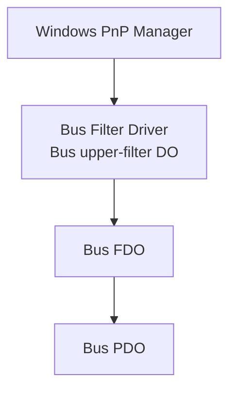
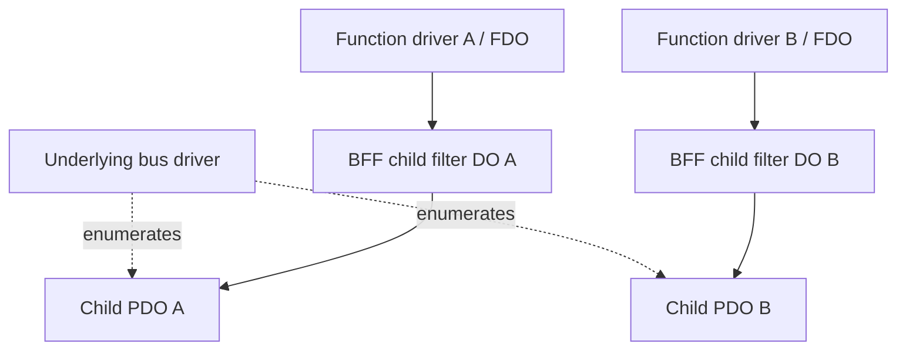
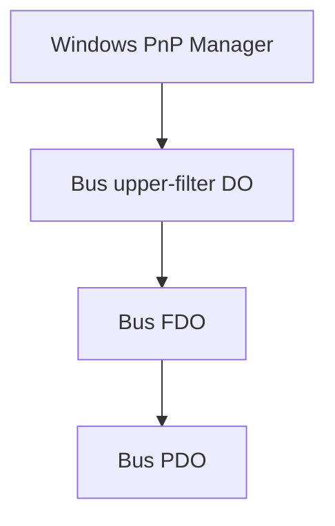
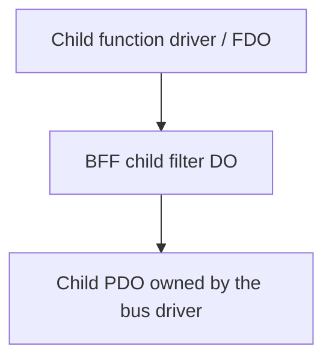
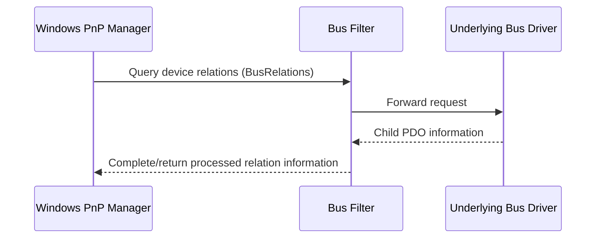
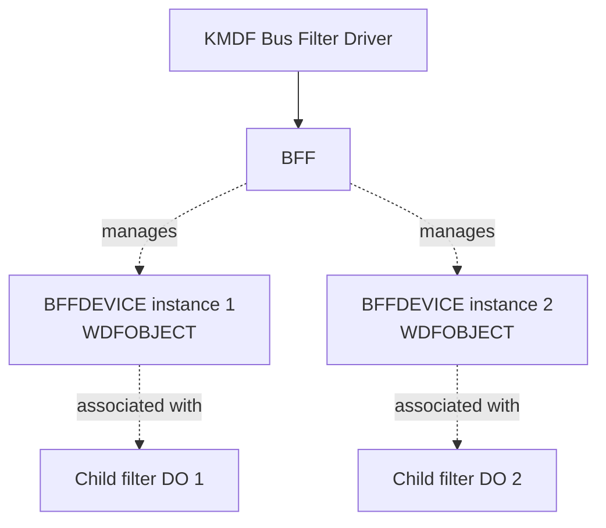
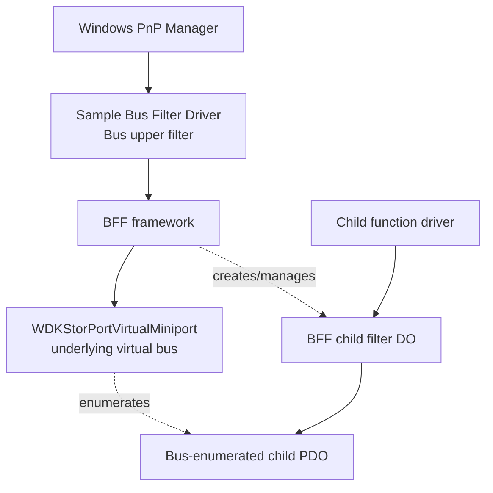

# BFF Architecture

This document explains the Windows device-stack model behind Bus Filter Framework (BFF), the responsibilities BFF provides, and how a BFF-based KMDF Bus Filter Driver interacts with the underlying bus and its child devices. It is intended for driver developers and technical evaluators who need to determine whether BFF fits a particular device-stack design.

For the project overview, build instructions, sample setup, compatibility status, licensing, and commercial inquiries, see the [README](README.md).

## Table of Contents

- [Overview](#overview)
- [Design Intent](#design-intent)
- [Key Terminology](#key-terminology)
- [What Defines a Bus Filter](#what-defines-a-bus-filter)
- [Bus Filter vs. Function Filter](#bus-filter-vs-function-filter)
- [Potential Applications](#potential-applications)
- [The Two Device-Stack Levels](#the-two-device-stack-levels)
- [Bus Relations and Child-Device Enumeration](#bus-relations-and-child-device-enumeration)
- [Child-Device Identity Filtering](#child-device-identity-filtering)
- [Child-Device Lifecycle](#child-device-lifecycle)
- [BFF Object Model](#bff-object-model)
- [Initialization and Integration Flow](#initialization-and-integration-flow)
- [Division of Responsibilities](#division-of-responsibilities)
- [Sample Driver Architecture](#sample-driver-architecture)
- [Why BFF Exists](#why-bff-exists)
- [Scope and Limitations](#scope-and-limitations)
- [Production Integration Checklist](#production-integration-checklist)
- [BFF and DmfBusFilterExtension](#bff-and-dmfbusfilterextension)
- [Related Source Files](#related-source-files)

## Overview

BFF is reusable infrastructure for implementing Windows Kernel-Mode Driver Framework (KMDF) Bus Filter Drivers. It bridges the gap between the KMDF programming model and the lower-level WDM and Plug and Play (PnP) operations commonly required by a Bus Filter Driver.

BFF does not replace KMDF, the Windows PnP manager, or the underlying bus driver. Its purpose is to handle common Bus Filter infrastructure so that driver developers can concentrate on behavior specific to their target bus and child devices.

At a high level, a BFF-based driver combines two related roles:

1. It is an **upper filter in the bus device stack**.
2. It manages **filter device objects in the stacks of child devices enumerated by that bus**.

The second role is what distinguishes a Bus Filter from a filter that is attached only to one function device.

## Design Intent

BFF is intended to centralize common infrastructure used by KMDF-oriented Bus Filter Drivers. Its likely adopters are Windows kernel-mode driver developers and OEM/ISV teams whose product requires child-device filtering at the bus level. Its design separates reusable framework responsibilities from the bus-specific and product-specific behavior that belongs in the integrating driver.

The principal design goals are to:

- reduce repeated implementation of common Bus Filter and PnP plumbing;
- support child-device filter creation and lifecycle management in a reusable form;
- expose integration points for selected PnP and child-device identity behavior;
- avoid requiring the broader DMF framework as a dependency;
- leave bus enumeration and product policy decisions with the underlying bus driver and integrating driver, respectively.

BFF does not make a driver automatically compatible with every bus or device topology. The host driver must follow the target bus's PnP contract and validate the interactions that are relevant to its hardware.

## Key Terminology

| Term | Meaning |
|---|---|
| **Bus PDO** | The physical device object representing the bus device, created by the relevant parent enumerator. |
| **Bus FDO** | The functional device object created by the bus driver for its bus device stack. |
| **Bus upper-filter DO** | The filter device object attached above the bus FDO. This is the Bus Filter Driver's initial position in the bus device stack. |
| **Child PDO** | A physical device object returned by the bus driver when it enumerates a child device. |
| **Child filter DO** | The filter device object BFF creates and attaches to a child device stack before that child's function driver is loaded. |
| **Child function FDO** | The functional device object created by the function driver for the child device. It is normally above the child filter DO in the stack. |
| **`WDFDEVICE`** | The KMDF device object representing the Bus Filter Driver's bus upper-filter device. It is not a synonym for every child filter DO managed by BFF. |
| **`BFFDEVICE`** | A BFF-managed `WDFOBJECT` representing the framework's managed child-filter instance/state. It is an object abstraction, not itself the child filter DO, child PDO, or a `WDFDEVICE`. See [BFF Object Model](#bff-object-model). |

The terms *device object*, *framework object*, and *device stack* are related but not interchangeable. In particular, `BFFDEVICE` must not be described as if it were the actual child filter DO.

## What Defines a Bus Filter

In Windows driver terminology, *upper filter* describes where a filter is attached in a device stack. *Bus Filter* describes the driver's role in filtering child devices enumerated by the bus.

A simplified bus device stack is:

The Bus Filter is initially attached above the bus driver's FDO. During child-device enumeration, the underlying bus driver reports child PDOs. BFF-based logic can create and attach a child filter DO to a child device stack before the corresponding function driver is loaded.

The Bus Filter is therefore not merely a filter for ordinary I/O sent to the bus device itself. Its defining role is to filter the child devices produced by the bus.

## Bus Filter vs. Function Filter

Both Bus Filters and Function Filters are Windows filter drivers, but they are used for different purposes.

A conventional function filter operates on a particular function device. It may intercept operations such as `IRP_MJ_CREATE`, `IRP_MJ_READ`, `IRP_MJ_WRITE`, `IRP_MJ_DEVICE_CONTROL`, selected PnP requests, or power-management requests directed at that device.

A Bus Filter starts at the bus device stack and manages filter DOs for the bus's child devices.

| Aspect | Function Filter | Bus Filter |
|---|---|---|
| Primary target | A particular function device | Child devices enumerated by a bus |
| Initial attachment | The function device stack | The bus device stack, typically as an upper filter |
| Child PDO filtering | Not its defining role | Defining role |
| Bus relations | Usually not the main concern | Important to child enumeration and tracking |
| Child-device lifecycle | Usually outside its primary responsibility | A core responsibility |
| Typical use | Intercept requests for a known function device | Filter child devices before their function drivers load |

As a rule of thumb, if the requirement is primarily to intercept I/O requests for one known function device, a conventional KMDF Function Filter may be sufficient. If the requirement is to filter the child devices of a bus before their function drivers are loaded, a Bus Filter architecture is appropriate.

## Potential Applications

BFF is most relevant when a product needs the defining behavior of a Bus Filter: managing filter device objects for child devices enumerated by a bus, before their function drivers are loaded. Examples of potential applications include:

- integrating custom or virtual bus implementations with child-device filtering;
- customizing selected child-device identity information to support a product-specific driver-matching design;
- implementing specialized PnP behavior for devices exposed by a target bus;
- sharing Bus Filter infrastructure across related driver products.

These are implementation scenarios, not turnkey product features. BFF does not independently provide a device-management service, a general hardware-policy engine, file-content inspection, or a complete data-loss-prevention solution. An OEM or ISV evaluating BFF should treat it as a driver-infrastructure component to integrate and validate, not as a ready-to-deploy end-user product.

## The Two Device-Stack Levels

A Bus Filter works across two related levels of the Windows device hierarchy.

### 1. The bus device stack

The driver's bus upper-filter DO is attached above the bus FDO. This stack position lets the driver participate in selected requests sent to the bus device, including the PnP operations relevant to child-device enumeration.

### 2. The child-device stacks

For each child PDO that needs filtering, BFF manages a child filter DO attached above the PDO. The child's function driver can then create its FDO above the filter DO.

The driver therefore has objects associated with both the bus stack and child stacks. The bus upper-filter device and a child filter DO have different roles and lifetimes.

## Bus Relations and Child-Device Enumeration

`BusRelations` is an important part of the Bus Filter model because it is how the PnP manager obtains the set of child PDOs reported by a bus driver.

A simplified request flow is:

The underlying bus driver remains responsible for enumerating its child devices. A Bus Filter may inspect the returned child-device information and establish or maintain its filter instances for the relevant PDOs. The exact handling depends on the design of the particular Bus Filter Driver.

Any implementation that processes device relations must preserve the underlying bus driver's enumeration semantics and comply with PnP ownership and reference-counting requirements for device objects. BFF provides reusable infrastructure for this area; it does not replace the underlying bus's enumeration responsibility.

## Child-Device Identity Filtering

A Bus Filter may customize selected identity information associated with a child device, such as Compatible IDs. This can influence how Windows matches the child device to a driver package.

The sample driver demonstrates this concept by prepending `BffDevice` to the Compatible IDs returned by the underlying bus driver. The sample is an illustration of identity customization; it is not a general recommendation to change device identity in every driver.

Identity customization must be intentional and compatible with the target device's PnP behavior, driver matching, and installation package.

## Child-Device Lifecycle

Because a Bus Filter manages child filter DOs, it must also manage each instance's lifetime. Common concerns include:

- detecting newly enumerated child devices;
- creating and attaching child filter DOs;
- maintaining per-child state;
- forwarding or handling relevant PnP requests;
- handling orderly removal and surprise removal;
- releasing references, remove locks, and other framework resources at the correct time.

These activities may interleave with PnP requests and other driver callbacks. A production Bus Filter must account for concurrency, object lifetime, and the IRQL constraints of each callback. The framework is intended to reduce repeated infrastructure work, not eliminate the need to understand the target bus's PnP contract.

## BFF Object Model

BFF distinguishes the KMDF device representing the bus upper filter from the framework objects used to manage child filtering.

- The **`WDFDEVICE`** represents the Bus Filter Driver's bus upper-filter device object.
- A **child filter DO** is the actual device object attached to a child device stack.
- **`BFFDEVICE`** is a framework-managed `WDFOBJECT` associated with the managed child-filter instance and its framework state. It is not the child filter DO itself, the child PDO, or a `WDFDEVICE`.

Conceptually, BFF manages a relationship between each framework object and the corresponding child-filter device object:

The framework exposes operations for accessing information associated with a BFF-managed child-filter instance, including the underlying WDM device object, the next lower device in the stack, the physical device object (PDO), and remove-lock management. Consult [`bff/bff.h`](bff/bff.h) for the actual public API and its contracts.

Do not infer that `BFFDEVICE` is itself a device object merely because its name contains “DEVICE.” Its type and lifetime are those of a framework object.

## Initialization and Integration Flow

A typical integration follows this conceptual sequence:

BFF exposes initialization APIs including `BffSetInitializationData(...)` and `BffInitialize(...)`. `BffInitialize` is called after `WdfDriverCreate`; follow the sample and the public header for the precise call sequence, callback contracts, and required parameters.

The sample driver is the reference implementation for how the framework is integrated with a KMDF driver. Start with [`BusFilter/Driver.c`](BusFilter/Driver.c) and the declarations in [`bff/bff.h`](bff/bff.h).

## Division of Responsibilities

The division between framework infrastructure and driver-specific behavior is intentional.

| Concern | BFF's role | Bus Filter Driver author's role |
|---|---|---|
| Framework integration | Provide APIs and common Bus Filter infrastructure | Configure BFF and follow its callback/API contracts |
| Bus stack | Support the Bus Filter role and relevant infrastructure | Define bus-specific behavior and any bus-specific request handling |
| Child filtering | Create/manage framework-supported child filter instances | Decide which child-device behavior to implement |
| PnP and relations | Encapsulate common plumbing where practical | Ensure the implementation meets the target bus's PnP contract |
| Device identity | Provide relevant integration points | Decide whether and how identity information should be customized |
| Child lifecycle | Provide reusable lifecycle support | Maintain correct device-specific state and resource usage |
| Product behavior | Not provided by the framework | Implement the behavior that makes the driver useful for its product |

## Sample Driver Architecture

The repository's sample Bus Filter Driver is designed to work with the `WDKStorPortVirtualMiniport` project, which is included as a Git submodule. The sample is intended to demonstrate BFF integration and child-device filtering.

| Component | Role |
|---|---|
| Sample Bus Filter Driver | Implements the sample's device-specific Bus Filter behavior |
| BFF | Provides reusable Bus Filter and child-filter infrastructure |
| `WDKStorPortVirtualMiniport` | Supplies the underlying virtual-bus functionality used by the sample |
| Child PDO | Represents a child device enumerated by the bus |
| BFF child filter DO | Filters the child stack before its function driver is loaded |
| Child function driver | Implements the child device's function-specific behavior |

The sample changes information associated with a child device while leaving the actual bus functionality to the underlying bus driver.

## Why BFF Exists

KMDF simplifies many aspects of Windows kernel-mode driver development, but it does not provide a high-level abstraction for every part of the Bus Filter pattern described here. Implementing a Bus Filter commonly requires interaction with lower-level WDM and PnP infrastructure, including:

- PnP IRPs and device relations, especially `BusRelations`;
- child PDOs and device-stack traversal;
- request forwarding and completion;
- child-device filter creation and attachment;
- device identification;
- child-device lifetime and surprise removal;
- remove-lock and reference management.

Without reusable infrastructure, a substantial portion of a Bus Filter Driver can become repeated plumbing rather than product-specific behavior. BFF aims to centralize common parts of that work so a driver author can focus on the behavior required by the target bus and its child devices.

## Scope and Limitations

BFF is an infrastructure layer for implementing Bus Filter Drivers. It does not replace:

- Windows Driver Frameworks (WDF) or KMDF;
- the Windows PnP manager;
- the underlying bus driver or its enumeration responsibilities;
- the function drivers for child devices;
- a device-specific or product-specific policy engine;
- a file-system filter or a complete data-loss-prevention (DLP) solution.

BFF also does not hide every WDM concept. Bus Filter Drivers inherently interact with parts of Windows PnP and device-stack infrastructure below the normal KMDF abstraction level.

A Bus Filter should not be selected simply because the product involves hardware. If the requirement is to filter file-system operations, enforce file-content policies, or control requests for a known function device, additional or different Windows driver components may be more appropriate. Select the attachment point and enforcement layer according to the actual data path and security requirements.

The sample demonstrates a development and learning scenario. For production use, validate the target Windows/KMDF versions, signing and deployment requirements, hardware topology, PnP behavior, concurrency, power transitions, removal paths, and applicable driver-verification/HLK requirements.

## Production Integration Checklist

Before integrating BFF into a production driver, evaluate at least the following:

- **Bus contract:** confirm that the target bus enumerates the relevant child PDOs and that the driver attaches at the intended point in the bus device stack.
- **Identity and matching:** validate any Hardware ID or Compatible ID customization against the target device's intended driver-matching and installation behavior.
- **PnP lifecycle:** test arrival, query/remove, orderly removal, surprise removal, re-enumeration, and failure paths.
- **Concurrency and lifetime:** review callback synchronization, object references, remove-lock usage, and cleanup ordering.
- **Power behavior:** test the applicable power transitions and the target bus's interaction with child devices.
- **Compatibility:** define supported Windows, KMDF, WDK, hardware, and bus-topology combinations rather than assuming universal coverage.
- **Validation:** use Driver Verifier and applicable HLK tests as appropriate; a successful build alone is not evidence of runtime correctness or certification.
- **Failure recovery:** document installation, update, rollback, and recovery procedures, especially where a filter may affect multiple child devices.

This checklist is a starting point, not a certification claim. The integrating organization remains responsible for validating its driver and product.

## BFF and DmfBusFilterExtension

BFF and [DmfBusFilterExtension](https://git.nefarius.at/nefarius/DmfBusFilterExtension) both aim to simplify Windows Bus Filter Driver development, but they take different architectural approaches.

| Aspect | BFF | DmfBusFilterExtension |
|---|---|---|
| KMDF-oriented | Yes | Yes |
| Requires DMF | No | Yes |
| Bus Filter infrastructure | Yes | Yes |
| Child-device abstraction | `BFFDEVICE` (`WDFOBJECT`) | `DMFBUSCHILDDEVICE` handle abstraction |
| Broader framework dependency | Focused on the Bus Filter problem | Integrated with the DMF ecosystem |

BFF is intentionally focused on Bus Filter infrastructure without requiring the broader DMF framework. `DmfBusFilterExtension` may be a natural option for projects already using DMF. Evaluate each option against the target driver's architecture, dependencies, licensing, and maintenance requirements.

## Related Source Files

- [`bff/bff.h`](bff/bff.h) — public BFF API declarations.
- [`BusFilter/Driver.c`](BusFilter/Driver.c) — sample integration and driver-specific behavior.
- [`WDKStorPortVirtualMiniport/`](https://github.com/abysdom/WDKStorPortVirtualMiniport/tree/62463ffb8f5892e18878ef83783c8cfee3aa5d5b) — the sample's underlying virtual-bus project (Git submodule).
- [`mp/mp.sln`](mp/mp.sln) — Visual Studio solution.
