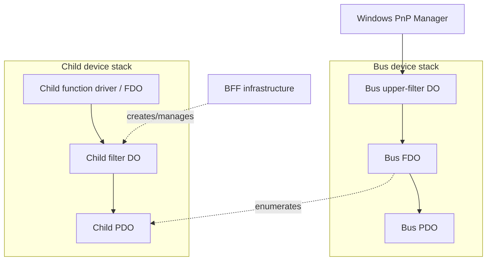

# Bus Filter Framework (BFF)

<p align="center">
  
</p>

<p align="center">
  <strong>Reusable KMDF-oriented infrastructure for building Windows Bus Filter Drivers.</strong>
</p>

Bus Filter Framework (BFF) is an open-source framework for Windows Kernel-Mode Driver Framework (KMDF) developers who need to build a **Bus Filter Driver**. It provides reusable infrastructure for managing filter device objects on bus-enumerated child devices before their function drivers are loaded, helping reduce repeated low-level WDM and Plug and Play (PnP) work.

BFF is intended to help driver developers focus on bus-specific and product-specific behavior instead of repeatedly implementing common Bus Filter plumbing. It is primarily aimed at Windows driver developers and may also be relevant to OEMs and ISVs building proprietary hardware platforms or Windows driver products.

> **In one sentence:** Use BFF when your KMDF driver needs to act as an upper filter for a bus and filter that bus's child devices—not simply to intercept I/O for one known function device.

## Table of Contents

- [Why BFF?](#why-bff)
- [Is BFF a Fit?](#is-bff-a-fit)
- [Architecture at a Glance](#architecture-at-a-glance)
- [Key Capabilities](#key-capabilities)
- [Quick Start](#quick-start)
- [Sample Driver](#sample-driver)
- [Installing the Sample Driver](#installing-the-sample-driver)
- [Uninstalling the Sample Driver](#uninstalling-the-sample-driver)
- [Compatibility and Testing Status](#compatibility-and-testing-status)
- [Potential Applications and Future Direction](#potential-applications-and-future-direction)
- [Documentation](#documentation)
- [Commercial Licensing and Engineering Services](#commercial-licensing-and-engineering-services)
- [Contributing](#contributing)
- [License](#license)
- [Community and Support](#community-and-support)

## Why BFF?

- **Reduce repeated WDM/PnP plumbing.** Reuse infrastructure related to Bus Relations, child-device filtering, and child-device lifecycle management.
- **Work in a KMDF-oriented driver.** Integrate Bus Filter functionality without adopting the broader DMF framework.
- **Filter child devices at the right stage.** Establish child filter device objects before the corresponding function drivers are loaded.
- **Start from real code.** Review the sample KMDF Bus Filter Driver and its integration with BFF.
- **Keep product behavior in your driver.** BFF supplies infrastructure; you implement the behavior specific to your bus, child devices, and product requirements.

## Is BFF a Fit?

BFF may be a fit if you are developing a Windows driver for a custom or virtual bus, or if your design needs to manage and filter child devices enumerated by a bus. Potential use cases include:

- custom hardware integration that requires child-device filtering;
- changing selected child-device identification information, such as Compatible IDs, before driver matching;
- implementing bus-specific PnP behavior around enumerated child devices;
- reusing Bus Filter infrastructure across related driver projects.

BFF is **not** a universal Windows device-filtering framework. If you only need to intercept I/O requests for one known function device, a conventional function filter may be more appropriate.

For the device-stack model, `BusRelations`, child-device lifecycle, the `BFFDEVICE` object model, and the sample architecture, see [ARCHITECTURE.md](ARCHITECTURE.md).

## Architecture at a Glance

A Bus Filter has two related roles: it is attached as an upper filter in the bus device stack, and it manages filter device objects in the stacks of child devices enumerated by that bus.



This is a conceptual stack diagram, not a complete representation of every Windows PnP interaction. The distinction between the bus upper-filter `WDFDEVICE`, the child filter DO, and the framework-managed `BFFDEVICE` (`WDFOBJECT`) is important; see [BFF Object Model](ARCHITECTURE.md#bff-object-model).

## Key Capabilities

- KMDF-oriented Bus Filter infrastructure.
- Child filter device creation and lifecycle management.
- Integration points for selected PnP operations and Bus Relations processing.
- Support for selected child-device identity customization, including Compatible IDs.
- Access to related device-stack objects and remove-lock management through the public API.
- Integration into a KMDF driver without requiring DMF.

These capabilities are infrastructure building blocks, not a turnkey device-management or security product. The exact supported behavior and callback contracts are defined by the public API and sample implementation.

## Quick Start

### Requirements

The current build configuration targets:

- Windows 10 or later;
- Visual Studio 2022;
- Windows Driver Kit (WDK) 10.0.26100 or later;
- NuGet package restore.

The projects use the WDK NuGet packages introduced with WDK 26100. This is the documented build target, not a claim that every possible target Windows version and hardware configuration has been production-validated.

### Clone the Repository

The sample depends on the `WDKStorPortVirtualMiniport` Git submodule. Clone recursively:

```powershell
git clone --recurse-submodules https://github.com/abysdom/bus-filter-framework.git
```

If you already cloned the repository without its submodules:

```powershell
git submodule update --init --recursive
```

### Build

Open `mp\mp.sln` in Visual Studio and build the solution. You can also build from a Developer Command Prompt:

```powershell
msbuild mp\mp.sln
```

NuGet package restore must be available to the build environment. The repository's GitHub Actions workflow builds the project to help detect build regressions; a successful build does not by itself establish runtime correctness or HLK compliance.

## Sample Driver

The `BusFilter/` directory contains a sample KMDF Bus Filter Driver demonstrating BFF initialization, callbacks, child-device filter creation, PnP handling, device-interface registration, Compatible ID customization, interaction with the underlying bus driver, and KMDF device/queue management.

The sample uses `WDKStorPortVirtualMiniport`, included as a Git submodule, for its underlying virtual-bus functionality. See [Sample Driver Architecture](ARCHITECTURE.md#sample-driver-architecture).

## Installing the Sample Driver

The sample is intended for development and experimentation, not as a production-ready driver package. Use a disposable test system or virtual machine, and ensure you have a recovery path before changing driver settings. The driver package requires an appropriate test-signing environment.

Enable test signing from an elevated command prompt:

```powershell
bcdedit /set testsigning on
```

Reboot Windows after enabling test signing. Create the sample root-enumerated device:

```powershell
devgen /add /bus ROOT /hardwareid root\mp
```

`DevGen` is a WDK test utility available with the Windows 11 version 22H2-era WDK and later. See Microsoft's [DevGen command syntax](https://learn.microsoft.com/en-us/windows-hardware/drivers/devtest/devgen-command-syntax). It is a development utility and should not be redistributed or used as part of a production installation workflow.

Then install the generated driver package (run the command from the directory containing the generated INF, or provide its full path):

```powershell
pnputil /add-driver install.inf /install
```

The `install.inf` package is generated by the `install` project. The `WDKStorPortVirtualMiniport` submodule also contains installation documentation for the virtual bus device.

## Uninstalling the Sample Driver

Find the sample device's **device instance ID**. On Windows 11 version 21H2 or later, you can enumerate devices matching the sample hardware ID:

```powershell
pnputil /enum-devices /deviceid root\mp
```

On older Windows versions, use Device Manager or another available device-enumeration tool to obtain the exact instance ID. Use that ID to remove the sample device (do not use `/deviceid` in the removal command unless you intend to remove every device matching that hardware ID):

```powershell
pnputil /remove-device "<device-instance-id>"
```

See Microsoft's [PnPUtil command syntax](https://learn.microsoft.com/en-us/windows-hardware/drivers/devtest/pnputil-command-syntax). Then remove the installed driver package:

```powershell
pnputil /delete-driver oemXX.inf
```

Replace `oemXX.inf` with the published OEM INF name assigned by Windows. Follow the submodule's documentation as needed to remove the underlying virtual miniport device.

## Compatibility and Testing Status

The current documented build target is Windows 10 or later, Visual Studio 2022, and WDK 10.0.26100 or later with the corresponding WDK NuGet packages.

The sample is primarily a development and learning resource. Before using BFF in a production driver, validate the supported Windows/KMDF versions, signing and deployment requirements, target hardware and bus topology, PnP and power behavior, concurrent operations, removal paths, and applicable driver-verification requirements.

More comprehensive Windows Hardware Lab Kit (HLK) testing documentation is planned and is not yet included in this repository. Do not interpret the availability of a build workflow as evidence that the sample has passed HLK or has been validated across all hardware configurations.

## Potential Applications and Future Direction

BFF may serve as a foundation for custom hardware integration, specialized child-device behavior, or other products that need a Bus Filter Driver. The framework does not itself provide the full product behavior in any of these areas; implementers must supply and validate their device-specific logic.

One exploratory direction is to investigate BFF-based components for **USB Mass Storage device policy and data-leak prevention (DLP)**. This is a potential future application—not a capability of the current BFF release. Feedback from Windows driver developers, OEMs, and ISVs with concrete requirements would help assess whether this is a useful direction.

## Documentation

- [Architecture](ARCHITECTURE.md) — device-stack model, Bus Relations, child-device lifecycle, object model, responsibilities, and limitations.
- [Public API](bff/bff.h) — declarations and API contracts.
- [Sample implementation](BusFilter/Driver.c) — example BFF integration.
- [Project FAQ](https://bus-filter-framework.blogspot.com/p/faq.html) — common Bus Filter and BFF questions.
- [Project documentation site](https://bus-filter-framework.blogspot.com/) — additional background and sample information.

## Commercial Licensing and Engineering Services

BFF Community Edition is licensed under GPL v3. Organizations that need to incorporate BFF into proprietary software or distribute closed-source Windows drivers can inquire about a commercial license. Commercial engagement may also cover BFF integration, custom Bus Filter Driver development, maintenance, and technical support.

For commercial licensing or engineering inquiries, email the maintainer at [yangyuanzhi+bff@gmail.com](mailto:yangyuanzhi+bff@gmail.com) or use the [project contact page](https://bus-filter-framework.blogspot.com/p/contact_10.html). For public technical questions, design discussions, and feature requests, use [GitHub Discussions](https://github.com/abysdom/bus-filter-framework/discussions). Please do not post confidential product details or proprietary information in public discussions.

See [LICENSE](LICENSE) for the Community Edition license text. Commercial terms and scope should be agreed separately with the maintainer.

## Contributing

Contributions are welcome. Before submitting a pull request, review:

- [`CONTRIBUTING.md`](CONTRIBUTING.md)
- [`CONTRIBUTOR_LICENSE_AGREEMENT.md`](CONTRIBUTOR_LICENSE_AGREEMENT.md)
- [`CODE_OF_CONDUCT.md`](CODE_OF_CONDUCT.md)

By submitting a contribution, you agree to the project's Contributor License Agreement (CLA). The CLA allows contributors to retain copyright ownership while granting the project maintainer the rights necessary to distribute the project under open-source and commercial licenses.

Please ensure that changes follow the existing coding style, are documented appropriately, build with the documented WDK, and include relevant testing information where applicable.

## License

Bus Filter Framework Community Edition is licensed under the GNU General Public License version 3 (GPL v3). See [LICENSE](LICENSE) for the complete license text.

## Community and Support

- For technical questions, bug reports, and feature discussions, use [GitHub Discussions](https://github.com/abysdom/bus-filter-framework/discussions).
- For project background and FAQs, visit the [BFF documentation site](https://bus-filter-framework.blogspot.com/).
- To support continued development, see the [donations page](https://bus-filter-framework.blogspot.com/p/donation.html).

You can also explore the project using:

[](https://deepwiki.com/abysdom/bus-filter-framework)
